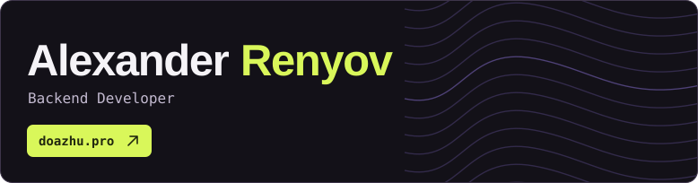
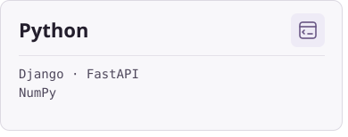
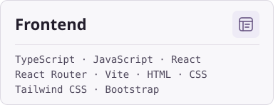
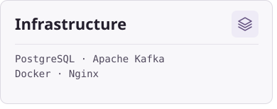

  <a href="https://doazhu.pro/">
    <picture>
      <source media="(max-width: 600px)" srcset="./assets/profile-mobile.svg">
      
    </picture>
  </a>

I build APIs in Go and Python and work with PostgreSQL. I'm studying IT and business analysis at university.

[Portfolio](https://doazhu.pro/work) · [Email](mailto:me@doazhu.ru) · [Telegram](https://t.me/Doazhu) · [VK](https://vk.com/doazhu)

## Stack

  
  
  
  

**APIs** · REST, OpenAPI, Swagger, JWT  
**Design & docs** · Figma, LaTeX
