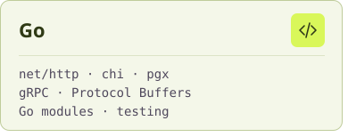
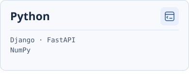
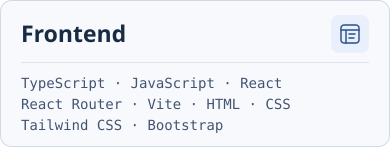

# Alexander Renyov

**Full-stack developer** · IT and business analysis student

I got into web development three years ago. I build APIs, work with PostgreSQL, and use React for the frontend.

Most of my recent work is on GitLab.

[Email](mailto:me@doazhu.ru) · [Telegram](https://t.me/Doazhu) · [VK](https://vk.com/doazhu)

## Stack

  
  
  
  

**APIs** · REST, OpenAPI, Swagger, JWT  
**Design & docs** · Figma, LaTeX
